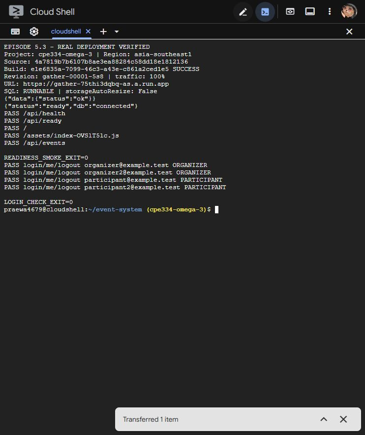

# Lab 5 deployment and CI procedure

Status: Episode 4 is integrated on main. The first manual Episode 5 deployment
was verified on 19 November 2026; its execution and remaining acceptance work
are tracked in [Issue #45](https://github.com/PhraewaS/event-system/issues/45).
The public C-04 workflow, teammate evidence verification, and later identity,
main-only deployment pipeline and persistence gates remain separate work.

## Stack and accepted starting point

Gather uses React/TypeScript/Vite → Express → PostgreSQL, with one root npm
lockfile. Express serves the API and built frontend from the same image.
Versioned SQL and `pg` replace the example's Prisma commands. Docker runs as
`node` on port 8080; local Compose maps port 3000 and starts database → migration
→ app. See [local Docker procedure](../../docker-episode3.md) and
[readiness audit](../../cloud-run-readiness.md).

PR #39 prepared the application. PR #40 was independently approved and merged
into staging at `c2fd354e616c921d7f888f589631fb9d41a93947`; the fresh isolated-clone
execution is recorded in [Issue #43](https://github.com/PhraewaS/event-system/issues/43).
The original accepted application tag `v0.1.0` keeps its own 43-test history.
The later staging suite contains 47 tests and 12 browser cases.

## Environment inventory

Copy the root `.env.example` to ignored `.env` and fill values privately.
CI uses synthetic values only in its disposable `event_system_test` database.

| Variable | Purpose / scope | Secret? | Value source |
| --- | --- | --- | --- |
| DATABASE_URL | API, migration and seed PostgreSQL connection | Yes | Private local environment; deployed `gather-database-url` Secret Manager reference |
| SESSION_SECRET | Stable signing secret shared by app instances | Yes | Generate at least 32 random characters; deployed `gather-session-secret` reference |
| PORT | Listener; app binds 0.0.0.0 | No | Local setting or Cloud Run-provided port |
| NODE_ENV | Development/test/production behavior | No | Execution environment; production for deployed web |
| DB_POOL_MAX | Connections per process, integer 1–100; default 10 | No | Set against actual database/instance budget before cloud use |
| DEMO_PASSWORD | Explicit demo seed only, 12–256 characters | Yes | Private local environment or separate seed-job secret |
| ALLOW_DEMO_SEED | Explicit production seed opt-in; otherwise false | No | Separate seed job only; absent on web service |
| TEST_DATABASE_URL | Dedicated disposable database ending in _test | Yes | Private test environment or synthetic CI service URL |
| POSTGRES_PASSWORD | Local Compose database password | Yes | Private ignored environment; URL-safe for interpolation |

The client reads no environment variables and calls the API on the same origin.
Never copy server settings into VITE variables. Seed reruns preserve existing
accounts/passwords and records; changing a seed variable does not rotate an
existing account password.

Deployment scripts also read `PROJECT_ID`, `REGION`, `DRY_RUN`, and release
`IMAGE_TAG` (full 40-character SHA), `ROLLBACK`, optional service/job names and
`GITHUB_ENV`. These are non-secret identifiers/controls. Actual project, region
and resource identifiers must be confirmed from team setup and the approved #45
deployment; they are not inferred from the template defaults.

## Build, test and local runtime commands

Node 24 and a separate disposable PostgreSQL test database are required for host
tests. Tests clear only the guarded *_test database.

```sh
npm ci
npm run db:migrate
# Set DEMO_PASSWORD privately before explicit seeding.
npm run db:seed
npm run build
npm test -- --reporter=verbose
npx playwright install chromium
npm run test:e2e
docker compose --env-file .env.example config --quiet
docker compose up --build -d
docker compose ps -a
node scripts/smoke.mjs http://localhost:3000
```

For Docker, migration runs in the separate `migrate` service; demo seeding is an
explicit command described in the existing Docker procedure. Use `docker compose
down` to retain its named database volume; do not add `-v` when proving data
survival. The fresh-clone evidence in #43 used its own project/volume and a
localhost-only port override, without reusing existing environment secrets.

## CI triggers, jobs and permissions

`.github/workflows/ci-docker.yml` is the single CI entry point. It replaces the
earlier `ci.yml`; historical runs/commits remain intact.

| Trigger / job | Behavior |
| --- | --- |
| pull_request into main or sprint1-staging | Checks feature/fix/docs integration PRs and release PRs |
| push to main or sprint*-staging | Checks the actual integrated source after merge |
| workflow_call | Same checks can be reused by the later deployment workflow |
| workflow_dispatch | Manual checks after this workflow is present on the default branch |
| test-and-docker | Offline deploy tests, root install/migrate/seed/build/tests, desktop/mobile browsers, Compose config, Docker build and source/test artifact |
| build-and-test | Compatibility gate: succeeds only when test-and-docker succeeds, preserving the existing required-check name |

The workflow is named **CI & Docker Build**. Contents permission is read-only;
checkout does not persist credentials. It performs no Google Cloud login,
resource changes, registry push or deployment. Concurrency cancels superseded
runs for the same workflow/ref. A cancelled run is not a passing check.

The existing branch protections require **build-and-test**. They are not changed
by this PR. Episode 6 can additionally select **test-and-docker** after the
reviewed workflow is available, with proof that a deliberately failing temporary
PR cannot merge (C-02). Preserve all current protections and history.

## Evidence index — version-specific results

| Check | Tested source / evidence | Result / limit |
| --- | --- | --- |
| C-01 existing readiness PR | [PR #39 CI](https://github.com/PhraewaS/event-system/actions/runs/43720996070/job/132832737171), submitted head 1261c11 | Build, 47 tests, 12 browser cases, Compose and Docker passed |
| C-01 existing Docker PR | [PR #40 CI](https://github.com/PhraewaS/event-system/actions/runs/43724811202/job/132844340937), submitted head 14e6a27 | Same regression/config/image checks passed |
| Integrated staging | [push CI](https://github.com/PhraewaS/event-system/actions/runs/44298279587/job/134780937962), c2fd354 | Build, 47 tests, 12 browser cases, Compose and Docker passed |
| C-03 fresh clone | [actual execution](https://github.com/PhraewaS/event-system/issues/43#issuecomment-6978931016), c2fd354 | New isolated Docker build/start/DB/browser/recreation checks passed; separate operator run |
| Episode 4 workflow and offline checks | [Issue #44](https://github.com/PhraewaS/event-system/issues/44) links the actual new PR/head/run and separate release PR | Current execution and review status recorded there; no acceptance claimed in advance |
| Historical main release | [PR #29 CI](https://github.com/PhraewaS/event-system/actions/runs/42826991379/job/129866787385) | Historical 43-test/12-browser result; not a new 47-test run or GCP deployment |

The workflow uploads `lab5-ci-evidence`; its source manifest and browser results
identify the tested source. Keep new-head CI distinct from older successful
runs. Starter Kit offline checks are extra script checks, not part of the
47 application tests or 12 existing browser cases.

The PR #50 review follow-up adds fail-closed Secret Manager inventory checks,
JavaScript response MIME validation and truthful teardown failure summaries.
Reproduce its offline regression suite using the commands in
[deploy/README.md](../../../deploy/README.md): 14 deployment/preview scenarios,
5 teardown scenarios, 5 release scenarios and 12 Python smoke tests. These use
local stubs/mocked HTTP only. Record the revised submitted head and hosted run
in #44; the earlier 40490e9 run remains historical evidence for that source.

## Episode 5 — actual first deployment, 19 November 2026

[Operator evidence](https://github.com/PhraewaS/event-system/issues/45#issuecomment-7009398933)
and [guluJa's review](https://github.com/PhraewaS/event-system/issues/45#issuecomment-7009707756)
record the actual execution. Approval of the `--demo` plan is recorded
[separately](https://github.com/PhraewaS/event-system/issues/45#issuecomment-7008337324).
These results identify the deployed application source, not the later parser
fix/documentation commit. No redeployment is implied by this document update.

| Identity | Verified value |
| --- | --- |
| Application source | `4a7819b7b6107b8ae3ea88284c58dd18e1812136`, clean tracked main checkout in Cloud Shell |
| Project / region | `cpe334-omega-3` / `asia-southeast1` |
| Cloud Build | [e1e6835a-7099-46c3-a43e-c861a2ced1e5](https://console.cloud.google.com/cloud-build/builds/e1e6835a-7099-46c3-a43e-c861a2ced1e5?project=297614851283), SUCCESS, 12:31:19–12:32:23 UTC |
| Image | `asia-southeast1-docker.pkg.dev/cpe334-omega-3/gather/gather@sha256:1aa3fc321eb7b581e8f14e41989f6b4b2e6fb7396be28469765a87d9f9bcccec` |
| Cloud Run | `gather`, revision `gather-00001-5s8`, Ready=True, 100% traffic; runtime digest matched the build |
| Public URL | https://gather-75thi3dqbq-as.a.run.app |
| Cloud SQL | `gather-pg`, POSTGRES_17, db-f1-micro, 10 GB SSD, RUNNABLE |
| Database / user / connection | `gather` / `gather` / `cpe334-omega-3:asia-southeast1:gather-pg` |
| Runtime service account | `gather-runner@cpe334-omega-3.iam.gserviceaccount.com` |

### Setup and recovery actually performed

Billing was linked and Free Trial was active before resource creation. The
existing budget alert was checked; it is an alert, not a spending cap. Billing
and budget settings were not changed. Paid resources now exist; no teardown
was performed during this deployment.

After the reviewed dry run, the operator started the initial setup from the
repository root with `PROJECT_ID=cpe334-omega-3`, `REGION=asia-southeast1` and
`bash deploy/deploy.sh --demo` (without `DRY_RUN=1`). The script enabled APIs,
created repository `gather`, the SQL instance/database, runtime identity and
the three app secrets. The runtime received Cloud SQL Client on this project
and Secret Accessor on individual app secrets, not project-wide Secret Accessor.
Generated credentials stayed private in Secret Manager.

This was **not an uninterrupted successful script run**. The first attempt
stopped at newly created runtime identity propagation. After verifying the
identity existed, retrying progressed to a Cloud Build source-read denial.
The actual default build account was the Compute Engine default account, so
the operator applied these scoped build grants:

```sh
gcloud storage buckets add-iam-policy-binding gs://cpe334-omega-3_cloudbuild \
  --member=serviceAccount:297614851283-compute@developer.gserviceaccount.com \
  --role=roles/storage.objectViewer --quiet
gcloud artifacts repositories add-iam-policy-binding gather \
  --location asia-southeast1 --project cpe334-omega-3 \
  --member=serviceAccount:297614851283-compute@developer.gserviceaccount.com \
  --role=roles/artifactregistry.writer --quiet
gcloud projects add-iam-policy-binding cpe334-omega-3 \
  --member=serviceAccount:297614851283-compute@developer.gserviceaccount.com \
  --role=roles/logging.logWriter --condition=None --quiet
```

No Owner, Editor or build-secret access was added. A later full-script retry
stopped safely because `gcloud secrets list --format='value(name)'` returned
short IDs while the original parser expected full resource names. Metadata-only
queries confirmed `gather-database-url`, `gather-session-secret` and
`gather-demo-password`, enabled version `1` of each, and SQL user `gather`.
The operator then resumed the reviewed steps 9–11 manually, without resetting
credentials or changing application source.

The parser fix accepts validated short IDs and full resource names before
normalizing the inventory. Failed listing or any malformed inventory line still
stops before credential changes. Offline rerun tests cover existing full-name
inventories and short-name inventories with and without `--demo`, asserting no password changes, secret
creation or new secret versions. This fix has not been validated by a new live
full-script rerun; the deployed results below are from the original source.

### Build, migrate, seed and serve — executed in order

The following commands reproduce the manual resumed steps, using the resource
identifiers that were already created and verified. They are live commands,
not a preview; review before using them again. `latest` was used for this first
manual deployment; the table above records the immutable digest actually served.

```sh
PROJECT_ID=cpe334-omega-3
REGION=asia-southeast1
IMAGE_URI=asia-southeast1-docker.pkg.dev/cpe334-omega-3/gather/gather:latest
SA_EMAIL=gather-runner@cpe334-omega-3.iam.gserviceaccount.com
SQL_CONN_NAME=cpe334-omega-3:asia-southeast1:gather-pg

gcloud builds submit --tag "$IMAGE_URI" --project "$PROJECT_ID"
gcloud run jobs deploy gather-migrate \
  --image "$IMAGE_URI" --region "$REGION" --service-account "$SA_EMAIL" \
  --set-cloudsql-instances "$SQL_CONN_NAME" \
  --set-secrets DATABASE_URL=gather-database-url:latest \
  --set-env-vars NODE_ENV=production,TZ=Asia/Bangkok,DB_POOL_MAX=3 \
  --command node --args dist/server/migrate.js \
  --max-retries 1 --task-timeout 300s --project "$PROJECT_ID"
gcloud run jobs execute gather-migrate --region "$REGION" --wait --project "$PROJECT_ID"

# Run only after migration succeeds; explicit demo seed, not a routine release.
gcloud run jobs deploy gather-seed \
  --image "$IMAGE_URI" --region "$REGION" --service-account "$SA_EMAIL" \
  --set-cloudsql-instances "$SQL_CONN_NAME" \
  --set-secrets DATABASE_URL=gather-database-url:latest,DEMO_PASSWORD=gather-demo-password:latest \
  --set-env-vars NODE_ENV=production,ALLOW_DEMO_SEED=true,DB_POOL_MAX=3 \
  --command node --args dist/server/seed.js \
  --max-retries 0 --task-timeout 300s --project "$PROJECT_ID"
gcloud run jobs execute gather-seed --region "$REGION" --wait --project "$PROJECT_ID"

# Run only after both awaited jobs succeed.
gcloud run deploy gather --image "$IMAGE_URI" --region "$REGION" \
  --platform managed --allow-unauthenticated --service-account "$SA_EMAIL" \
  --add-cloudsql-instances "$SQL_CONN_NAME" \
  --set-secrets DATABASE_URL=gather-database-url:latest,SESSION_SECRET=gather-session-secret:latest \
  --set-env-vars NODE_ENV=production,TZ=Asia/Bangkok,DB_POOL_MAX=3 \
  --min-instances 0 --max-instances 3 --memory 512Mi --cpu 1 --port 8080 \
  --project "$PROJECT_ID"
```

Build exited 0. Migration execution `gather-migrate-l6xpv` completed successfully
at **12:33:26 UTC**; demo seed `gather-seed-rrlqk` completed successfully at
**12:34:26 UTC**. The web revision became ready at **12:34:57 UTC**, after both
jobs. The web environment contains only `NODE_ENV`, `TZ`, `DB_POOL_MAX` and secret
references `DATABASE_URL` / `SESSION_SECRET`. It has neither `ALLOW_DEMO_SEED`
nor `DEMO_PASSWORD`.

### Storage, readiness, smoke and account checks

Storage auto-increase was disabled after the SQL instance became available,
before the resumed deployment, and queried again after web deployment:

```sh
gcloud sql instances patch gather-pg --project cpe334-omega-3 \
  --no-storage-auto-increase --quiet
gcloud sql instances describe gather-pg --project cpe334-omega-3 \
  --format='json(name,state,settings.dataDiskSizeGb,settings.storageAutoResize)'
```

Patch exited 0; final state was RUNNABLE, 10 GB and `storageAutoResize=false`.
Then the operator ran:

```sh
SERVICE_URL="$(gcloud run services describe gather --region asia-southeast1 \
  --project cpe334-omega-3 --format='value(status.url)')"
curl --fail --silent --show-error "$SERVICE_URL/api/health"
curl --fail --silent --show-error "$SERVICE_URL/api/ready"
python3 deploy/smoke_test.py "$SERVICE_URL"
```

Actual results (combined readiness/smoke exit 0):

```text
{"data":{"status":"ok"}}
{"status":"ready","db":"connected"}
PASS /api/health
PASS /api/ready
PASS /
PASS /assets/index-OVSlT5lc.js
PASS /api/events
```

The browser displayed the three seeded public events. A separate operator HTTP
check used cookie jars and CSRF tokens to log in, verify `/api/auth/me` and log
out (HTTP 204) for `organizer@example.test`, `organizer2@example.test`,
`participant@example.test` and `participant2@example.test`; all four passed.
It fetched the existing demo password into process memory and printed only
synthetic account identifiers/results, never credentials or response tokens.
These are API session checks, not a claim of a completed browser C-04 workflow.

### Shared capture and remaining acceptance



This is the saved **Cloud Shell terminal capture**, showing project, source,
build, revision, public URL, SQL auto-increase setting and check results. It is
not a Cloud SQL/Cloud Run Console overview screenshot or a C-04 screenshot.
The companion [metadata export](evidence/2026-11-19/deployment-metadata.json)
was copied with source SHA-256
`929b1cea1b442f437a1f485b534a6b848e0218f15fc2bc911ffd6326eed2676a`.
Original logs, including failed attempts, remain in Cloud Shell under
`~/event-system/artifacts/episode5-deployment/`. No secret payloads are shared.

Keep **#45 and #7 open**. C-04 still needs live Organizer sign-in/publish,
Participant sign-in/registration, owner roster and at least one rule/access
rejection, with URL-visible screenshots and source/revision context. Do not
substitute the API login checks, seeded event list or local tests for that
evidence. This documentation/parser change requires teammate review before
acceptance; later CI/CD and cloud persistence gates remain pending separately.

## Episode 4 integration and release procedure

1. Branch `ci/4-pr-checks` from accepted `sprint1-staging`; open a labelled PR
   into `sprint1-staging`, linked to #44.
2. Verify **test-and-docker** and dependent **build-and-test** on the submitted
   head. Resolve failures on that branch and obtain a specific non-author
   teammate review/approval.
3. Merge through the protected path; record actual staging merge and push CI.
4. Open/promote a separate `sprint1-staging` → `main` release PR containing the
   accepted readiness/Docker/CI increment. The same checks and independent
   release approval are required; a Draft release remains blocked until step 3.
5. Record the actual main merge and main CI before accepting #44/marking Done.
   This release only places reviewed CI/deployment preparation on main.
6. Episode 7 adds real main-only deployment. Then record tag/source SHA ↔
   immutable image ↔ pipeline run ↔ Cloud Run revision/public URL, and the
   procedure to query the currently running commit. No deployed identity exists
   in this Episode 4 evidence alone.

Keep #7 open for the wider lab. C-04 public workflow, C-05 cloud restart/redeploy
persistence and C-06 main-to-cloud pipeline proof remain separate gates.
