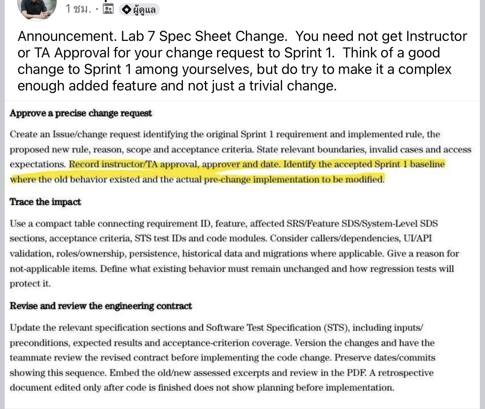

# Lab 7: source of the Instructor/TA approval waiver

Source: instructor course announcement titled **“Announcement. Lab 7 Spec Sheet Change.”**, supplied by a team member as the original screenshot `S__10330116.jpg`; preserved below. Source recorded with this contract revision on **24 November 2026**. This is the evidence-record date, not a claim about the announcement's publication date: the screenshot shows only the relative time **“1 ชม.”**, so an exact original posting date cannot be established from it. No original post URL was supplied.

The announcement states:

> You need not get Instructor or TA Approval for your change request to Sprint 1.

It also directs teams to agree on a sufficiently substantial added feature/change rather than a trivial one. This supersedes only the Lab 7 sheet's requirement to record Instructor/TA approval, approver and date. The precise change request, accepted baseline/pre-change implementation, impact analysis, versioned revised specification/STS and **teammate contract review before implementation** remain required. This source is not an approval of CR-L7-01 itself and does not replace PhraewaS's review.

