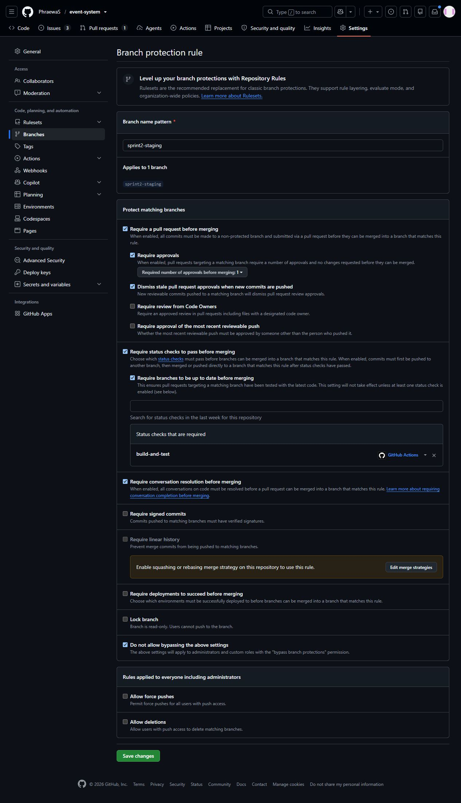

# DOC-S2-06 — Sprint 2 review/integration gate record

## ผลล่าสุดหลังผู้ดูแลบันทึกกฎ — 25 พฤศจิกายน 2026

`PhraewaS` ยืนยันการตั้ง classic protection วันที่ 25/11/2026 เวลา 14:06:16 น. UTC+7 ใน [คอมเมนต์ PR #86](https://github.com/PhraewaS/event-system/pull/86#issuecomment-7155505162) พร้อมภาพหน้าค่าที่บันทึกแล้ว `guluJa` ตรวจภาพและอ่าน branch API ซ้ำประมาณ 14:50 น. วันเดียวกัน ผลดังนี้:

| รายการ | ค่าจากภาพ Settings ที่ผู้ดูแลแนบ | ผลตรวจ |
| --- | --- | --- |
| Rule scope | classic; pattern `sprint2-staging`; applies to 1 branch | ตรง branch ที่ต้องการ |
| PR / independent approval | Require PR เปิด; approvals 1; dismiss stale approvals เปิด | ผ่าน |
| Required CI | `build-and-test` จาก GitHub Actions; up-to-date branch เปิด | ผ่าน |
| Review conversations | Require conversation resolution เปิด | ผ่าน |
| Admin/bypass | Do not allow bypassing the above settings เปิด | ผ่าน |
| Force push / deletion | Allow force pushes และ Allow deletions ปิด | ผ่าน |
| Last-push approval | Require approval of the most recent reviewable push ปิด | ตรง workflow เดิม |
| Merge workflow | Lock branch / Require linear history ปิด | ยังคงรับ reviewed merge commits ได้ |

REST `GET /repos/PhraewaS/event-system/branches/sprint2-staging` อ่านซ้ำได้:

```json
{"name":"sprint2-staging","sha":"e2b9842edef525b2e72f040c9f64fa99dbe0f2c2","protected":true}
```

API นี้ยืนยันการเปิด protection ส่วนค่ารายข้อยืนยันจากภาพและคำรับรองของผู้ดูแล ไม่อ้างว่าอ่าน detailed protection API สำเร็จ เพราะสิทธิ์ `guluJa` ยังได้404จาก endpointนั้น



ภาพเก็บตามต้นฉบับโดยไม่แก้ค่าในภาพ แหล่งต้นฉบับ: https://github.com/user-attachments/assets/a77facae-9c48-4103-baa9-5454b64c816b

**สถานะ:** ส่วน branch protection ของ DOC-S2-06 ตรวจยืนยันแล้ว ส่วนการอนุมัติ PR ยังรอ `PhraewaS` ตรวจ revision ล่าสุดและกด Approve จริง ไม่ถือว่าคอมเมนต์รับรอง contract เป็น formal approval

Contract v2 ที่ `425c630` ได้รับ substantive review จาก `PhraewaS` วันที่ 25/11/2026 04:47:36 น. และ [CI 45492463076](https://github.com/PhraewaS/event-system/actions/runs/45492463076) ผ่าน 81 unit/API/client tests และ 28 browser cases ผลนี้เป็นของ425c630; CI ของ commit ที่เพิ่มหลักฐานรอบนี้ต้องตรวจแยกใน PR #86 หลัง push

## ประวัติผลตรวจครั้งแรก — เก็บไว้ตามเวลาที่เกิดจริง

ตรวจ 25 พฤศจิกายน 2026 ประมาณ 04:31 น. UTC+7 · ผู้ดำเนินงาน `guluJa`; ผู้ดูแล/ผู้รีวิว `PhraewaS`

| Gate | ผลที่อ่านได้จริง | สถานะ |
| --- | --- | --- |
| PR #86 base/head | sprint2-staging ← codex/sprint2-contract; reviewed head a74a20f | ตรวจแล้ว |
| PR CI ของ head a74a20f | [run 45490133420](https://github.com/PhraewaS/event-system/actions/runs/45490133420): test-and-docker และ build-and-test SUCCESS | ผ่านเฉพาะ head นี้; revision ใหม่ต้องรันใหม่ |
| Independent contract review | PhraewaS CHANGES_REQUESTED 25/11 04:27:24; v2 รอตรวจซ้ำ | pending |
| sprint2-staging protection | REST branch response: protected=false, SHA e2b9842edef525b2e72f040c9f64fa99dbe0f2c2 | ยังไม่ผ่าน |
| Protection details | branches/sprint2-staging/protection ตอบ404 ด้วยสิทธิ์ที่ใช้ตรวจ; ยืนยันค่ารายข้อไม่ได้ | ให้ผู้ดูแลตรวจ/ตั้งและแนบหลักฐาน |

คำสั่งอ่านที่ใช้:

```powershell
gh api repos/PhraewaS/event-system/branches/sprint2-staging --jq '{name:.name,sha:.commit.sha,protected:.protected}'
gh api repos/PhraewaS/event-system/branches/sprint2-staging/protection
gh pr checks 86 --repo PhraewaS/event-system
```

ก่อนรับ feature implementation PR ให้ `PhraewaS` ตรวจ/ตั้ง ruleset หรือ branch protection ที่มีผลกับ sprint2-staging และแนบค่าที่ตรวจจริง: non-author approval อย่างน้อย1, required CI check ที่รันจริง, up-to-date branch, resolved conversations และไม่ใช้ force-push/deletion/bypass เพื่อข้าม gate ตาม workflow เดิม

ณ 04:31 น. ผล `protected=false` และ404ยังไม่ใช่หลักฐานว่าเปิด gates แล้ว จึงคง pending ในเวลานั้น ผลตรวจหลังผู้ดูแลบันทึกกฎอยู่ในส่วนล่าสุดด้านบน ไม่แก้ผลเดิมให้กลายเป็น PASS ย้อนหลัง
